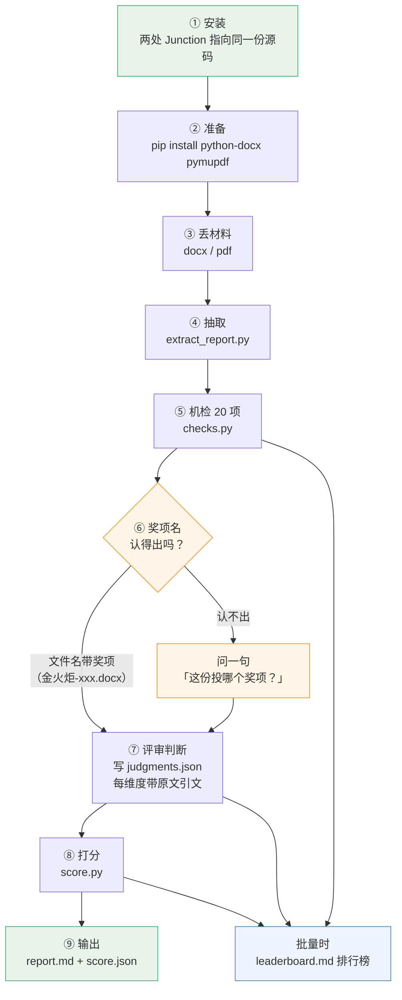

# 北斗奖评分技能｜安装 → 使用 → 输出

> 一张图看完。命令可直接复制。

## 一、总览



## 二、安装（一次性）

```bash
# 依赖
pip install python-docx pymupdf

# 两处安装：都指向同一份源码，改一处两处同步
mklink /J "%USERPROFILE%\.agents\skills\beidou-award-scorer" "E:\beikong-code\beidou-award-scorer"
mklink /J "%USERPROFILE%\.qwenworkcn\skills\beidou-award-scorer" "E:\beikong-code\beidou-award-scorer"
```

装完在任何会话里说「给这份申报材料打分」即可触发，**不需要再跑命令**。

## 三、单份材料

```bash
SKILL=~/.agents/skills/beidou-award-scorer
RUBRIC="E:/beikong-code/beidou-award-scorer/assets/rubric.example.json"

# 1) 抽取
python $SKILL/scripts/extract_report.py 材料.docx --out out/
#    → 材料.doc.json

# 2) 机检
python $SKILL/scripts/checks.py out/材料.doc.json --award 金火炬 --rubric $RUBRIC --out out/
#    → 材料.checks.json   (pass/warn/fail/na + 证据定位)

# 3) 评审判断（读 checks.json + doc.json 后填写，每维度必带原文引文）
#    模板：$SKILL/assets/judgments-template.md
#    → 材料.judgments.json

# 4) 打分
python $SKILL/scripts/score.py out/材料.doc.json \
    --checks out/材料.checks.json \
    --judgments out/材料.judgments.json \
    --award 金火炬 --rubric $RUBRIC --out out/
#    → 材料.score.json + 材料.report.md
```

## 四、批量材料

```bash
python $SKILL/scripts/batch.py "C:/材料目录" --out out/ --rubric $RUBRIC
# → 每份的 doc/checks/score/report + out/leaderboard.md 排行榜
```

**没有 `judgments.json` 的材料只出机检、不出分**——不会臆造分数。

## 五、输出物

| 文件 | 内容 |
|---|---|
| `材料.doc.json` | 抽出的正文 + 表格（按正文顺序，带章节路径） |
| `材料.checks.json` | 20 项机检结果，每条带证据定位 |
| `材料.judgments.json` | 评审判断（每维度：分/等级/理由/逐字引文） |
| `材料.score.json` | 维度得分、封顶、扣分、争议点、置信度 |
| `材料.report.md` | **给人看的报告**：结论 → 维度 → 扣分 → 争议点 → 改进建议 |
| `leaderboard.md` | 批量排行榜 |

`report.md` 的五节结构：

```
一、结论      总分 / 奖项区间 / 置信度 / 合成分
二、维度得分  每维度：官方口径 · 引文明细 · 封顶原因
三、扣分明细  扣了多少、为什么
四、争议点清单 ★ 给答辩评委用
五、改进建议  哪一维失分、补什么能加几分
```

## 六、什么时候会问你

| 情况 | 会不会问 |
|---|---|
| 文件名带奖项前缀（金火炬-xxx.docx） | **不问**，自动识别 |
| 文件名认不出奖项 | 问一句：「这份投哪个奖项？」 |
| 材料里有"金火炬/成果推广"字样 | 不问，正文能推出来 |
| 其他业务信息（名称/单位/投资额） | **不问**，材料里都有 |
| 命中否决项 | **不问**，写进争议点清单交答辩追问 |

## 七、三条铁律

1. **AI 不是加分项** —— 技术路线只做分类。
2. **没有引文就没有分** —— 每条判断都要有原文逐字片段，查不到即降级。
3. **已实现 ≠ 规划** —— 效益不区分两者，一律按规划计。

## 八、三条边界

- **机检只查形，不查真**：能说数字在不在、对不对得上，说不了数字是真是假。**所有 fail 都要回原文确认。**
- **奖项区间是相对刻度**（85/75/65/55），不是官方切线；无金标则无法校准绝对值。
- **不替代官方评审**：这是自查与初筛工具，最终裁定权在评委与综合审议。
